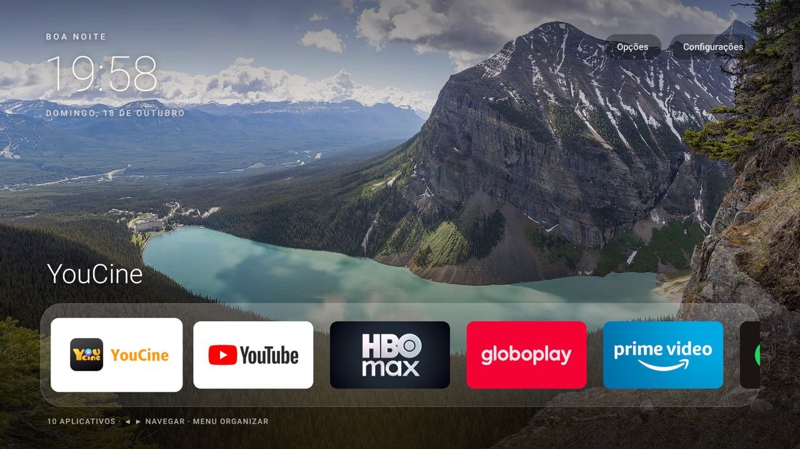

# Fire TV Home

Nosso launcher em português para Fire TV, com paisagem em tela cheia, relógio e dock de aplicativos inspirado na Apple TV. O projeto também reúne a limpeza seletiva e o filtro DNS, em módulos independentes e reversíveis.



## Organização

| Pasta | Conteúdo |
| --- | --- |
| [`launcher/`](launcher/) | Código Java, recursos, tradução pt-BR, compilação e instalação do launcher. |
| [`debloat/`](debloat/) | Listas de pacotes, ajustes de privacidade e restrições de segundo plano. |
| [`dns/`](dns/) | personalDNSfilter, listas de bloqueio e verificação de DNS. |
| [`firetv/`](firetv/) | Utilitários ADB e proteção de pacotes/UIDs compartilhados. |
| [`docs/`](docs/) | Compatibilidade, recuperação e registro da validação. |
| [`tests/`](tests/) | Testes locais das regras de segurança e backup. |

## Compatibilidade

Validado em Fire TV Stick HD, modelo **AFTSS (sheldon)**, **Fire OS 7.7.1.7**, Android 9/API 28, ARM de 32 bits. Os comandos de instalação exigem esse modelo e API. Outros aparelhos e versões precisam de um perfil revisado antes do uso.

O launcher usa componentes nativos do Android, sem bibliotecas externas e sem permissões solicitadas, incluindo acesso à internet. Mantém ordenação, ocultação e renomeação de apps, fundos personalizados e acesso às configurações do Fire OS. O serviço de acessibilidade redireciona o botão HOME; a tela inicial Amazon continua instalada.

## Preparação

Instale Python 3.10+ e Android Platform Tools (`adb`). Ative a depuração ADB no Fire TV e autorize a conexão exibida na televisão.

```sh
adb connect <IP_DA_TV>:5555
export ADB_SERIAL='<IP_DA_TV>:5555'
adb -s "$ADB_SERIAL" get-state
```

Execute os comandos na raiz deste repositório. O dispositivo precisa estar conectado; os scripts não procuram TVs na rede. Você também pode passar `--device '<IP_DA_TV>:5555'` em cada comando.

## Launcher

Requer JDK 17 e Android SDK com `platforms;android-28` e build-tools. Configure `JAVA_HOME` e `ANDROID_HOME` para suas instalações.

```sh
./launcher/build.sh
python3 launcher/manage.py install
```

A compilação gera `launcher/build/dumbtv-home.apk` e uma chave local. Guarde essa chave fora do Git: atualizações precisam da mesma assinatura. O instalador usa apenas o APK local e não baixa o launcher original de outro projeto. Veja [assinatura, atualização e retorno à tela Amazon](launcher/README.md).

## Debloat

Primeiro crie e revise o backup/plano. Depois aplique:

```sh
python3 debloat/manage.py snapshot --block-updates
# Revise .local/debloat/backup.json antes de continuar.
python3 debloat/manage.py apply
```

`--block-updates` inclui as restrições de OTA no plano. Omita essa opção no snapshot para preservar esses pacotes. Bloquear atualizações também impede correções de segurança e pode afetar a compatibilidade futura.

A limpeza **desativa**, sem desinstalar, os pacotes elegíveis. Preserva todos os apps de terceiros, Prime Video, integrações do Spotify e componentes essenciais. Serviços protegidos pela Amazon recebem restrições apenas quando o UID não é compartilhado com apps preservados. Use `--keep PACOTE` no snapshot para acrescentar exceções. Leia o [guia de debloat](debloat/README.md) antes de aplicar.

## DNS

Este perfil bloqueia telemetria, Alexa e endpoints de atualização. Usa personalDNSfilter como VPN **local** e encaminha consultas permitidas ao roteador. Não é uma VPN para mudar de país e ocupa a única vaga de VPN do Android.

```sh
python3 dns/manage.py install --block-updates
# A instalação reinicia a TV. Reconecte quando ela terminar de iniciar.
adb connect "$ADB_SERIAL"
python3 dns/manage.py verify
```

O instalador recusa substituir outra VPN ou uma instalação existente do filtro. Preserva os domínios de entrega de vídeo do Prime. As listas mudam com o tempo e algum aplicativo pode precisar de uma exceção. Veja o [guia DNS](dns/README.md).

## Desfazer por módulo

```sh
python3 debloat/manage.py restore
python3 dns/manage.py restore       # remove o filtro e reinicia a TV
# Reconecte ao ADB antes do próximo comando.
python3 launcher/manage.py restore # devolve HOME à configuração anterior
```

Cada módulo usa seu próprio backup em `.local/`, ignorado pelo Git. Guarde essa pasta: ela contém dados privados e o estado necessário para restauração. Não sobrescreva backups para repetir uma instalação; restaure, arquive o estado local e só então gere um plano novo. Veja [recuperação](docs/RECUPERACAO.md).

## Validação e limites

O launcher e os ajustes de origem foram aplicados e conferidos no aparelho acima. A reorganização dos scripts foi validada localmente; não foi reaplicada sobre a TV já configurada. Detalhes em [validação](docs/VALIDACAO.md).

```sh
python3 -m unittest discover -s tests -v
```

Os módulos não usam root, não alteram `/system` e não fazem restauração de fábrica. Este projeto não é afiliado à Amazon ou à Apple. O código é MIT; a fotografia tem licença própria, indicada abaixo e em [créditos do papel de parede](launcher/WALLPAPER-CREDITS.md).

## Créditos

- **[humblemuzzu/dumbtv](https://github.com/humblemuzzu/dumbtv)** — base do launcher, integração HOME/acessibilidade com Fire OS, listas de debloat e abordagem de filtro DNS. Copyright © 2026 dumbtv contributors, [licença MIT preservada](licenses/dumbtv-MIT.txt).
- **[mihirgupta0900/tv-home](https://github.com/mihirgupta0900/tv-home)** — referência e trechos adaptados da composição visual, cabeçalho, dock, foco e cor ambiente. Copyright © 2026 Mihir Gupta, [licença MIT preservada](licenses/tv-home-MIT.txt).
- **Fotografia de Lake Louise:** Chensiyuan, “[1 lake louise pano 2019](https://commons.wikimedia.org/wiki/File:1_lake_louise_pano_2019.jpg)”, [CC BY-SA 4.0](https://creativecommons.org/licenses/by-sa/4.0/). Versão 1920 × 1080 fornecida pelo tv-home, copiada sem novas alterações. A captura acima mostra essa fotografia na interface.
- **[personalDNSfilter](https://github.com/IngoZenz/personaldnsfilter)** e **[HaGeZi DNS Blocklists](https://github.com/hagezi/dns-blocklists)** — filtro externo e fonte das listas. O APK é obtido do F-Droid com SHA-256 verificado; código e binário do filtro não são redistribuídos neste repositório.
